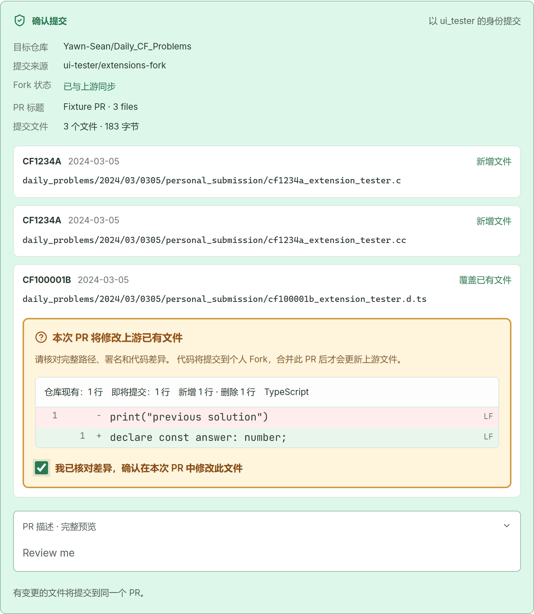
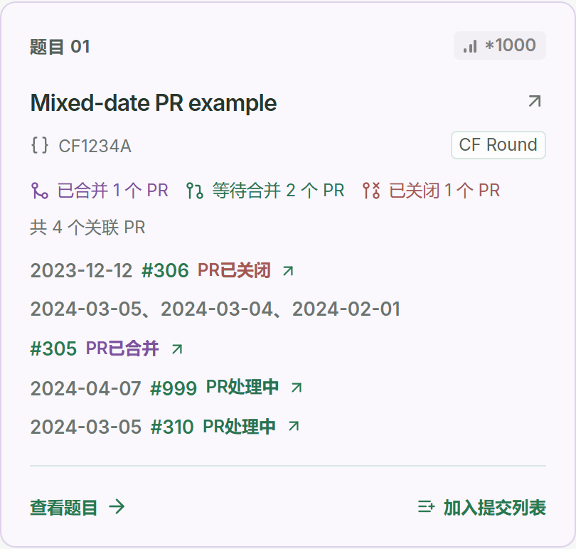

# 小羊肖恩的每日一题

面向 [小羊肖恩 Daily_CF_Problems](https://github.com/Yawn-Sean/Daily_CF_Problems) 的桌面客户端。浏览题库、阅读提示与题解、查看所有作者的参考代码，并通过 GitHub 提交自己的解答。使用打包后的客户端，无需安装 Git 或手动操作分支。

这是独立的社区项目，与题库作者及 Codeforces 无官方隶属关系。

- **题库仓库**：[Yawn-Sean/Daily_CF_Problems](https://github.com/Yawn-Sean/Daily_CF_Problems) — 题单、题解、参考代码与解答投稿。
- **客户端仓库**：[yanami-anna-meow/daily-cf-client](https://github.com/yanami-anna-meow/daily-cf-client) — 本程序的源码、问题反馈与功能改进。


*截图使用模拟数据，展示题库浏览布局；界面细节可能随版本更新。*

## 功能

- **浏览完整题库**：首页展示仓库最新题单；历史题库支持搜索、难度上下界和 Gym／CF Round 筛选，月份目录用于快速定位。支持补交旧题，不限制每日题目数量，也不排除仓库中的未来日期。
- **阅读学习材料**：在应用中查看提示、Markdown 与数学公式题解，以及所有作者的参考代码。代码支持语法高亮、复制和语言筛选；原始 Codeforces 题目链接在系统浏览器中打开。
- **增量更新题库**：首次下载公开题库，之后通过内置 Git 能力同步更新。启动、切换页面或手动刷新时检查远端；更新期间保留已有内容，失败时显示原因。
- **统一提交列表**：选择源码文件、填写署名、核对文件名，可以将不同日期、不同题目的多个文件一起创建为一个新 PR。支持 C、C++、Python 等常用语言，也可自由填写扩展名；导入文件保留实际后缀。
- **明确的投稿确认**：用户主动选择或创建 Fork。提交前检查同步状态、预览 PR 和文件差异；同名文件有覆盖提醒，确认基于实际路径与远端文件版本。客户端不修改已有 PR。
- **从 GitHub 读取提交状态**：关联当前账号向题库提交的 PR，包含在客户端之外创建的投稿，展示已合并、处理中和已关闭记录。遇到 API 返回范围限制时，保留已经读取的结果并说明不完整。
- **可调整的界面**：支持简体中文、English 和跟随系统；绿色、粉色、蓝色与黑白方案均可编辑，也可添加命名配色，搭配浅色、深色或跟随系统模式。
- **个人设置与登录**：支持 GitHub 设备授权和个人令牌登录、PR 模板变量、未保存修改提醒，以及配置文件和数据目录入口。

**这里的“提交”是向 GitHub 题库贡献代码。** 客户端不会向 Codeforces 交题，也不会运行、编译或评测导入的代码。

<details>
<summary>查看提交列表与 PR 状态示例（模拟数据）</summary>





</details>

## 安装与使用

首次公开提供源码。安装包会另行发布在 [GitHub Releases](https://github.com/yanami-anna-meow/daily-cf-client/releases)；请以具体版本的发布说明为准。如果尚无可下载的版本，可以按下文从源码运行。

项目采用 Electron、React 和 TypeScript，提供 Windows、macOS、Linux 构建配置。目前的本地桌面验证主要在 Windows 上完成；macOS、Linux 和各平台安装／卸载流程尚未全部实机验证。签名、公证和实际支持范围会在对应版本的发布说明中列明。

日常使用流程：

1. 打开客户端，等待首次题库同步；在最新题目或历史题库中选择题目。
2. 阅读提示、题解或参考代码，通过原题入口在浏览器中查看 Codeforces 题面。
3. 点击“加入提交列表”，导入源码，填写署名并核对扩展名与目标文件名。可以继续加入其他题目。
4. 登录 GitHub，明确选择自己的 Fork，或主动创建后确认使用。
5. 打开提交列表并预览 PR，核对来源 Fork、目标题库、文件差异及正文；确认需要覆盖的文件后提交。
6. 在提交记录中查看 PR 和合并状态。

提交列表只保留在本次运行的内存中；退出或刷新程序前会提示未提交内容，不保存个人代码草稿。题库、偏好设置和可加密保存的登录状态保存在本机，详情见[使用指南](docs/user-guide.md)与[安全和隐私说明](docs/security.md)。

## 从源码运行

推荐使用 Node.js 24 与 npm。先克隆本仓库，再安装依赖：

```sh
git clone https://github.com/yanami-anna-meow/daily-cf-client.git
cd daily-cf-client
npm ci
```

复制 `.env.example` 为 `.env`。要使用 GitHub 浏览器授权，填写启用了 Device Flow 的 OAuth App 的公开 Client ID：

```dotenv
GITHUB_CLIENT_ID=你的OAuthAppClientID
DAILY_CF_REPOSITORY=Yawn-Sean/Daily_CF_Problems
```

Client ID 可以公开，**不要填写 Client Secret 或访问令牌**。未配置时仍可浏览题库，也可在客户端使用个人令牌登录。OAuth App 的创建和权限说明见[登录配置](docs/github-setup.md)。

```sh
npm run dev
```

此命令启动本地 Vite 服务和 Electron。界面支持热更新；修改主进程、预加载脚本或 `.env` 后需要重新启动。仅做界面开发时可使用 `npm run dev:web`，浏览器预览不具备桌面端的真实登录、文件和投稿能力。

常用命令：

| 命令 | 用途 |
| --- | --- |
| `npm run typecheck` | TypeScript 类型检查 |
| `npm test` | 自动化测试 |
| `npm run test:ui` | 使用模拟数据运行浏览器界面测试 |
| `npm run build` | 检查类型并构建界面与 Electron 程序 |
| `npm start` | 启动已经构建的程序 |
| `npm run pack` | 生成本机平台的解包应用 |
| `npm run dist -- --publish never` | 生成本机平台安装包，输出到 `release/` |
| `npm run dist:win -- --publish never` | 在 Windows x64 生成安装版与免安装版 |

完整构建配置、跨平台打包和发布前检查见[发布指南](docs/releasing.md)。

## 参与开发

欢迎通过本仓库的 [Issues](https://github.com/yanami-anna-meow/daily-cf-client/issues) 反馈客户端问题，或提交 Pull Request。题解投稿和题库资料问题请前往[上游题库](https://github.com/Yawn-Sean/Daily_CF_Problems)。

开发与测试约定见 [CONTRIBUTING.md](CONTRIBUTING.md)。真实投稿联调应使用自己控制的测试仓库作为目标，不能向正式题库发送测试 PR。

```text
electron/            Electron 主进程、登录、GitHub 访问、Git 题库与存储
shared/              数据契约、解析、文件路径、模板与输入校验
src/                 React 界面
tests/               自动化测试
scripts/             开发、构建与验证脚本
docs/                使用、登录、安全与发布文档
.github/workflows/   三平台检查与安装包构建
```

## 许可

客户端源码采用 [MIT License](LICENSE)。上游题库、Codeforces 题面和参考解答保留各自作者的权利与许可，不因本客户端的许可证而改变。感谢小羊肖恩及题库贡献者长期维护每日一题。
