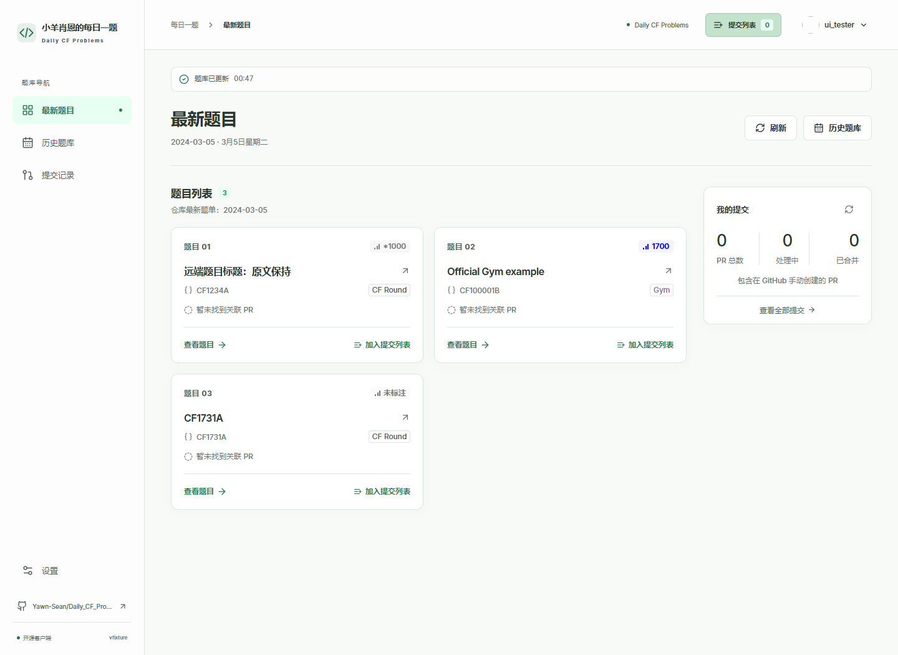

# Daily CF Client

English · [简体中文](README.zh-CN.md)

A desktop app for [Yawn-Sean's Daily CF Problems](https://github.com/Yawn-Sean/Daily_CF_Problems) (小羊肖恩的每日一题). Browse the problem archive, read hints and solutions, and contribute your code through GitHub without managing Git branches yourself.

[Download](https://github.com/yanami-anna-meow/daily-cf-client/releases/latest) · [User guide](docs/user-guide.md) · [Report an issue](https://github.com/yanami-anna-meow/daily-cf-client/issues)



*Screenshot uses sample data. The app is available in English and Simplified Chinese.*

## Download

Get the package for your computer from the [latest release](https://github.com/yanami-anna-meow/daily-cf-client/releases/latest).

| System | Architecture | Packages |
| --- | --- | --- |
| Windows | x64 — most Intel and AMD PCs | NSIS installer or portable `.exe` |
| Windows | arm64 — Windows on Arm | NSIS installer or portable `.exe` |
| macOS | x64 — Intel | `.dmg` or `.zip` |
| macOS | arm64 — Apple Silicon | `.dmg` or `.zip` |
| Linux | x64 | `.AppImage` or `.deb` |
| Linux | arm64 | `.AppImage` or `.deb` |

File names include the version and architecture. Each release lists its available packages and checksums. Packaged apps include the Git functionality they need; you do not need to install Git or Node.js.

The current packages are unsigned, and macOS packages are not notarized. Your operating system may show a security prompt. Read the release notes for the checks completed on that version; a successful build does not mean every installer has been tested on a physical machine.

## What it does

- Browse the latest problems or the full archive. Search by problem, title, hint, or date; filter by difficulty and contest type; jump to a month.
- Read hints, editorials with math formulas, and reference code from all contributors. Open the original Codeforces link in your browser.
- Keep a local copy of the public problem repository, with incremental updates on startup, page changes, and refresh. Existing content remains visible while an update runs.
- Add code files from several problems to a submission list, then create one pull request. Choose or create your fork, preview the changes, and confirm any overwritten files.
- See your GitHub pull requests beside each problem, including contributions made outside the app.
- Use English or Simplified Chinese, light or dark mode, and editable color schemes.

Submissions contribute files to the GitHub problem repository. The app does not submit to the Codeforces judge or run your code.

## First contribution

1. Open a problem and select **Add to submission list**.
2. Choose your source file, enter the author name to use in its repository filename, and check the filename preview. Add more files or problems if needed.
3. Sign in to GitHub and explicitly select or create a fork.
4. Open the submission list, review the pull request and file changes, and submit.

The submission list lasts for the current app session. Your settings and a local copy of the public problem repository are stored on your computer. See the [user guide](docs/user-guide.md) for details and the [security notes](docs/security.md) for how login credentials and local files are handled.

## Run from source

Use Node.js 24 and npm:

```sh
git clone https://github.com/yanami-anna-meow/daily-cf-client.git
cd daily-cf-client
npm ci
npm run dev
```

For browser-based GitHub login, copy `.env.example` to `.env` and set the public Client ID of a GitHub OAuth App with Device Flow enabled:

```dotenv
GITHUB_CLIENT_ID=your-public-client-id
DAILY_CF_REPOSITORY=Yawn-Sean/Daily_CF_Problems
```

Do not put a Client Secret or access token in that file. Without a Client ID, you can still browse the library and sign in with a personal access token. See [GitHub login setup](docs/github-setup.md).

`npm run dev` starts Vite and Electron. Restart it after changing the main process, preload script, or `.env`. For interface work alone, `npm run dev:web` provides a browser preview without the desktop app's login, file access, or submission features.

| Command | Purpose |
| --- | --- |
| `npm run typecheck` | Check TypeScript types |
| `npm test` | Run automated tests |
| `npm run test:ui` | Test the interface with sample data |
| `npm run build` | Build the renderer and Electron app |
| `npm start` | Run the built app |
| `npm run pack` | Create an unpacked app for the host platform |
| `npm run dist -- --publish never` | Build packages for the host platform |

See [CONTRIBUTING.md](CONTRIBUTING.md) for development and testing, and the [release guide](docs/releasing.md) for platform-specific builds.

## Project and license

This is an independent community project, not an official Codeforces or Yawn-Sean app.

- [Client repository](https://github.com/yanami-anna-meow/daily-cf-client): app source, issues, and pull requests.
- [Problem repository](https://github.com/Yawn-Sean/Daily_CF_Problems): problem lists, learning materials, and solution contributions.

The client is licensed under the [MIT License](LICENSE). Problem statements, editorials, and contributed solutions retain their authors' licenses. Thanks to Yawn-Sean and the contributors who maintain the problem collection.
